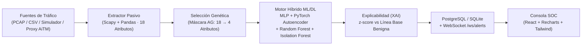

<div align="center">

# CIPHERTRACE AI

**Detección Pasiva de Amenazas en Tráfico Cifrado con IA Híbrida, Algoritmo Genético, Explicabilidad (XAI) y Laboratorio AiTM**

[](https://www.python.org/)
[](https://fastapi.tiangolo.com/)
[](https://pytorch.org/)
[](https://react.dev/)
[](https://www.typescriptlang.org/)
[](https://tailwindcss.com/)
[](https://www.postgresql.org/)
[](https://docs.docker.com/compose/)

</div>

---

## ¿Qué es CIPHERTRACE AI?

**CIPHERTRACE AI** es una plataforma SOC (*Security Operations Center*) de análisis pasivo diseñada para detectar amenazas avanzadas ocultas dentro de tráfico cifrado **sin descifrar jamás el payload** ni requerir inspección SSL/TLS invasiva (*TLS MITM*).

En lugar de romper el cifrado de las comunicaciones, el motor extrae **18 características pasivas observables** en red (temporización inter-paquete, distribución de tamaños, asimetría de bytes, cabeceras no cifradas `ClientHello`/`ServerHello`, entropía Shannon del SNI, tasa DNS/DoH, latencia de doble salto y redirecciones) para identificar 5 categorías de tráfico:

| Vector | Descripción | Señales pasivas clave |
| :--- | :--- | :--- |
| **`BENIGN`** | Tráfico HTTPS/TLS legítimo | SNI de baja entropía, latencia directa, 0 redirecciones |
| **`C2_BEACONING`** | *Command & Control* periódico | Desviación IAT muy baja, paquetes uniformes pequeños, pocos *cipher suites* |
| **`DOH_TUNNEL`** | Tunelización *DNS-over-HTTPS* | Alta entropía Shannon y longitud en SNI/subdominios, alta tasa DNS/DoH |
| **`EXFILTRATION`** | Exfiltración masiva de datos | Asimetría saliente marcada (`bytes_sent >> bytes_recv`), paquetes cercanos al MTU |
| **`PHISHING_AITM`** | Proxy inverso *Adversary-in-the-Middle* | Latencia de doble salto elevada (`>200 ms`), cadena de redirecciones TLS/HTTP |

---

## Arquitectura y Funcionamiento



### Motor IA & Optimización con Algoritmo Genético

1. **Fase 1 del Algoritmo Genético (Selección de Atributos):** reduce los **18 atributos pasivos** iniciales a **4 características óptimas** (**77.8% menos dimensionalidad**):
   - `bytes_sent` · `pkt_size_mean` · `tls_version_num` · `sni_length`
2. **Fase 2 del Algoritmo Genético (Pesos del Ensamble Híbrido):** combina la probabilidad supervisada de la red **MLP** (amenazas conocidas) con el error de reconstrucción del **PyTorch Autoencoder** entrenado únicamente con tráfico benigno (detección *Zero-Day*):
   ```text
   risk_score = 0.75 * P(MLP) + 0.25 * Anomaly(Autoencoder)      |      Umbral ALTO >= 0.50
   ```
3. **Explicabilidad (XAI):** calcula los 3 atributos con mayor desviación (`|z-score|`) respecto al perfil benigno basal y genera explicaciones claras en español para el analista SOC.

### Rendimiento Validado (Validación Cruzada `k = 5`, 6,000 flujos)

| Modelo | Paradigma | Precisión | Recall | F1-Score | Latencia Media |
| :--- | :--- | :---: | :---: | :---: | :---: |
| **Random Forest** | Supervisado Multiclase | 100.00% | 100.00% | 100.00% | 0.0303 ms |
| **Red Neuronal MLP** | Deep Learning Supervisado | 99.83% | 99.93% | 99.88% | 0.0028 ms |
| **PyTorch Autoencoder** | No Supervisado (*Zero-Day*) | 94.75% | 99.90% | 97.26% | 0.0007 ms |
| **Isolation Forest** | Anomalía No Supervisada | 94.72% | 89.17% | 91.86% | 0.0206 ms |
| **Ensamble Híbrido (AG)** | **MLP + Autoencoder Ponderado** | **99.87%** | **99.93%** | **99.90%** | **0.0035 ms** |

> Matriz de confusión del ensamble híbrido sobre 6,000 flujos: `TN = 2,996`, `FP = 4`, `FN = 2`, `TP = 2,998`.

---

## Las 4 Vistas de la Consola SOC

1. **Live SOC Overview:** incluye el panel **Sensor Híbrido (Captura Pasiva En Vivo / Offline)** para iniciar o detener la captura pasiva en tiempo real sobre interfaces de red (`scapy.sniff`), KPIs en vivo (*Flujos Analizados*, *Alertas Activas*, *Latencia Media*, *Tasa de Anomalía*), gráfica temporal de `risk_score`, distribución por vector de amenaza y tabla filtrable (`TODOS`, `ALTO`, `MEDIO`, `BAJO`) con **Drawer XAI** interactivo.
2. **Laboratorio AiTM & Inyección:** inyección controlada de los 5 escenarios (`POST /api/lab/simulate`), portales locales comparativos (`Portal Legítimo` vs. `Proxy Inverso AiTM` con relay HTTP real e interceptación de cookie), guía paso a paso y feed WebSocket en tiempo real.
3. **Motor IA & Algoritmo Genético:** procedencia trazable del dataset (`backend/data/raw/` vs. respaldo estadístico), curvas de convergencia generacional del AG (Fase 1 y Fase 2), mapa visual de atributos seleccionados/descartados, pesos óptimos, matriz de confusión y comparativa `k=5`.
4. **Inspector Pasivo PCAP / CSV (Modo Offline):** carga *Drag & Drop* de archivos `.pcap`, `.pcapng` y `.csv` hacia `POST /api/analyze/file` con desglose de detecciones flujo por flujo.

---

## Cómo Utilizarlo

### Opción 1: Docker Compose (Recomendada — 1 comando)

Requisitos: **Docker** y **Docker Compose**.

```bash
git clone https://github.com/JoelFlC/CIPHERTRACE-AI.git
cd CIPHERTRACE-AI
docker compose up -d --build
```

Esto levanta automáticamente 3 contenedores conectados en la red `ciphertrace-net` con puertos estándar (`8000` y `5173`):
- **`ciphertrace-db`**: PostgreSQL 16 (`ciphertrace_db`) con persistencia en el volumen `pgdata` y `healthcheck`.
- **`ciphertrace-backend`**: FastAPI + Uvicorn en `:8000` con capacidades `NET_RAW` / `NET_ADMIN` para captura pasiva en vivo, creación automática de tablas y montaje de `./backend/artifacts` y `./backend/data/raw`.
- **`ciphertrace-frontend`**: React + Nginx en `:5173`.

#### Perfil Opcional en Linux (`host-capture`) para Capturar la Interfaz Física Real (`eth0` / `wlan0`)
Si deseas capturar directamente el tráfico de la tarjeta física de red de tu equipo Linux desde Docker:
```bash
docker compose --profile host-capture up -d --build db backend-host frontend
```

**Comandos útiles del día a día:**
```bash
docker compose up -d       # Encender los servicios sin reconstruir imágenes
docker compose ps          # Verificar estado de contenedores
docker compose logs -f     # Ver logs en tiempo real
docker compose stop        # Detener contenedores conservando los datos
docker compose down        # Detener y eliminar contenedores (mantiene pgdata)
```

---

### Opción 2: Ejecución Local sin Docker (SQLite Fallback)

Si `DATABASE_URL` no está definida, el backend usa automáticamente `sqlite:///./ciphertrace.db`.

**1. Backend (Python 3.11+ en puerto 8000)**
```bash
cd backend
python3 -m venv .venv
source .venv/bin/activate
pip install --extra-index-url https://download.pytorch.org/whl/cpu -r requirements.txt
uvicorn app.main:app --host 0.0.0.0 --port 8000 --reload
```

**2. Frontend (Node.js 20+ en puerto 5173)**
```bash
cd frontend
npm install
npm run dev
```

---

## URLs Clave

| Recurso | URL | Propósito |
| :--- | :--- | :--- |
| **Consola SOC (Frontend)** | `http://localhost:5173` | Interfaz principal de monitorización y análisis |
| **Documentación API (Swagger)** | `http://localhost:8000/docs` | Explorador interactivo OpenAPI |
| **Estado del Sistema** | `http://localhost:8000/api/health` | Verificación de modelos cargados, pesos AG y WebSocket |
| **Portal Legítimo (Demo)** | `http://localhost:8000/lab/legit-portal` | Línea base de login TLS directo (~25 ms) |
| **Proxy Inverso AiTM (Demo)** | `http://localhost:8000/lab/aitm-proxy` | Simulación controlada de phishing AiTM de doble salto |

---

## Endpoints Principales de la API

| Método | Ruta | Descripción |
| :--- | :--- | :--- |
| `GET` | `/api/health` | Estado del motor híbrido y artefactos cargados |
| `GET` | `/api/dashboard/summary` | KPIs agregados del SOC y distribución de amenazas |
| `GET` | `/api/flows` | Flujos analizados y alertas recientes (`limit`, `risk_level`) |
| `GET` | `/api/ml/metrics` | Métricas `k=5` de modelos e historial de convergencia del AG |
| `POST` | `/api/lab/simulate` | Inyección controlada de tráfico (`BENIGN`, `C2_BEACONING`, `DOH_TUNNEL`, `EXFILTRATION`, `PHISHING_AITM`) |
| `POST` | `/api/analyze/file` | Análisis pasivo offline de capturas `.pcap`, `.pcapng` o `.csv` |
| `GET` | `/api/capture/interfaces` | Lista de interfaces y verificación de privilegios `CAP_NET_RAW` |
| `POST` | `/api/capture/start` | Inicia la captura pasiva en vivo por ventanas sin descifrar payload |
| `POST` | `/api/capture/stop` | Detiene la captura pasiva en vivo |
| `WS` | `/ws/alerts` | Stream WebSocket en tiempo real de flujos evaluados y alertas |

---

## Datasets Públicos, Muestras de Demo y Suite End-to-End

Para entrenar con datasets públicos reales (`CIC-IDS2017`, `CTU-13`, `BCCC-CIRA-CIC-DoHBrw-2020`), coloca los `.csv` en `backend/data/raw/` y ejecuta:

```bash
backend/.venv/bin/python backend/scripts/prepare_public_datasets.py --train
```
*(Si `backend/data/raw/` está vacía o faltan clases como `PHISHING_AITM`, el pipeline usa respaldo estadístico/de laboratorio y registra la procedencia exacta en `model_metrics.json`.)*

El proyecto incluye un generador de capturas reales (`.csv` y `.pcap` construido con Scapy) en `demo_samples/` y pruebas End-to-End automatizadas:

```bash
# Generar demo_samples/mixed_traffic_demo.csv (40 flujos) y sample_capture.pcap (5 flujos)
backend/.venv/bin/python backend/scripts/generate_demo_files.py

# Ejecutar la suite completa End-to-End (8/8 validaciones)
backend/.venv/bin/python backend/tests/test_e2e.py
```

---

## Guion de Demostración (3 Minutos)

1. **0:00 – 0:45 · Live SOC Overview (`http://localhost:5173`):** muestra el estado **LIVE** del WebSocket, el indicador **Análisis Pasivo (Sin Descifrado)** y las gráficas en vivo.
2. **0:45 – 1:45 · Detección AiTM en Vivo:** entra a **Laboratorio AiTM**, abre el **Proxy Inverso AiTM (Demo)** en otra pestaña y envía el formulario con las credenciales ficticias precargadas. Regresa a la consola SOC para ver la alerta `PHISHING_AITM` en tiempo real y abre su **Drawer XAI** (`double_hop_latency_ms`, `redirect_count`, `sni_length`).
3. **1:45 – 2:30 · Motor IA & Algoritmo Genético:** enseña cómo el AG redujo de 18 a 4 atributos optimizando el F1-Score hasta **99.90%**.
4. **2:30 – 3:00 · Inspector PCAP / CSV:** arrastra `demo_samples/sample_capture.pcap` o `demo_samples/mixed_traffic_demo.csv` para demostrar la extracción pasiva y clasificación flujo por flujo.

---

## Estructura del Proyecto

```text
CIPHERTRACE-AI/
├── backend/
│   ├── app/
│   │   ├── api/            # Endpoints REST y WebSocket (/api, /ws/alerts)
│   │   ├── core/           # Esquema de 18 atributos pasivos y rutas de artefactos
│   │   ├── db/             # Configuración SQLAlchemy (PostgreSQL + SQLite fallback) y modelos
│   │   ├── lab/            # Portales locales controlados (/lab/legit-portal, /lab/aitm-proxy)
│   │   ├── ml/             # Dataset builder, Autoencoder PyTorch, Algoritmo Genético, extractor PCAP
│   │   ├── services/       # Motor de inferencia XAI, simulador de tráfico y gestor WebSocket
│   │   └── main.py         # Punto de entrada FastAPI
│   ├── artifacts/          # Modelos entrenados (.joblib, .pt), ga_config.json y model_metrics.json
│   ├── data/processed/     # Dataset procesado de 6,000 flujos
│   ├── scripts/            # generate_demo_files.py
│   ├── tests/              # Suite End-to-End (test_e2e.py)
│   ├── Dockerfile
│   ├── entrypoint.sh
│   └── requirements.txt
├── frontend/
│   ├── src/
│   │   ├── components/     # Sidebar, RiskBadge, FlowDetailDrawer (XAI)
│   │   ├── pages/          # OverviewPage, ThreatLabPage, ModelAnalyticsPage, FileInspectorPage
│   │   ├── services/       # Cliente REST y hook useAlertWebSocket
│   │   └── types/          # Tipos TypeScript alineados con la API
│   ├── Dockerfile
│   └── nginx.conf
├── demo_samples/           # mixed_traffic_demo.csv y sample_capture.pcap
├── docker-compose.yml
└── README.md
```
